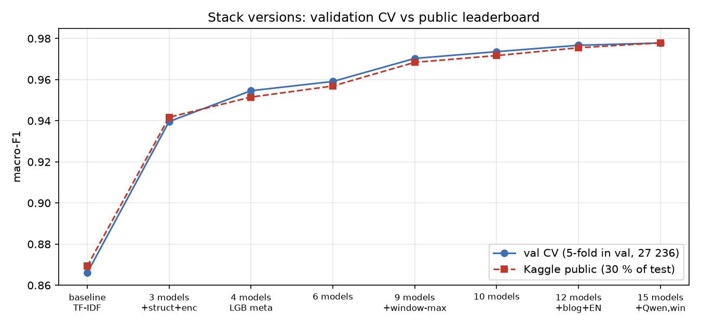
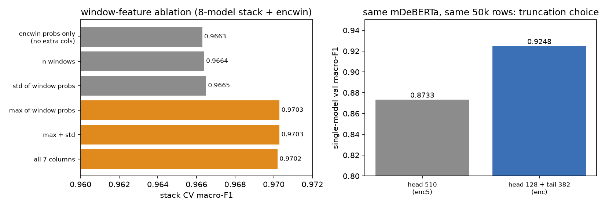
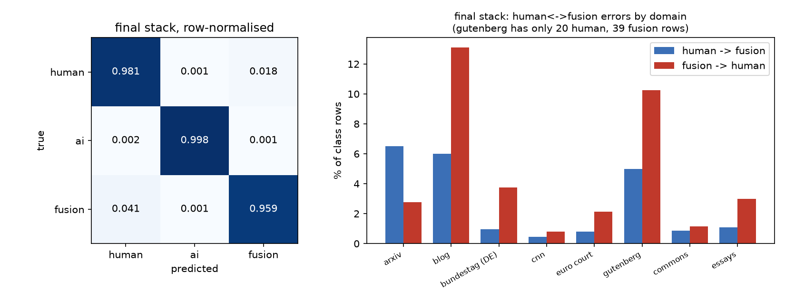
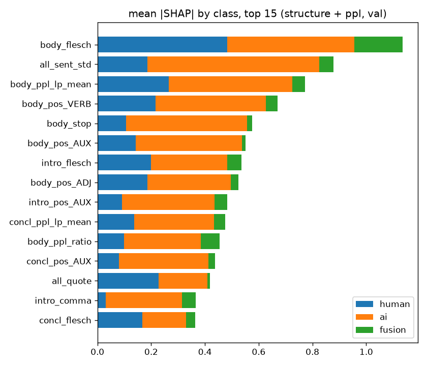

# Homework 3 -- AI-Generated Text Detection

author: [Nazar Mykhailyshchuk](https://github.com/partum55)

## Task

Classify a text as **human**, **ai**, or **fusion** (human text partly rewritten by an LLM). Metric: macro-F1.

Data: 272k training texts, 25k test texts, 8 domains (essays, Bundestag, CNN, blogs, House of Commons, EU court, arXiv, Gutenberg), English + German, no paragraph breaks.

The AI class is easy (recall ≥ 99.6 % for every strong model). **The whole problem is human vs. fusion.**

Validation: a fixed stratified 10 % split of train (27,236 rows). All numbers below are on it unless marked *public*.

## What I did

1. **Baseline:** TF-IDF (word + char n-grams) + logistic regression → macro-F1 0.866 (public 0.869).
2. **Two feature groups** (idea from Tripto et al., EMNLP 2025: intro / body / conclusion differ between human and AI text):
   structure + stylometry features (readability, sentence-length spread, POS shares, punctuation) and perplexity features from a small open LM (Qwen2.5-0.5B). LightGBM → 0.816 alone.
3. **Fine-tuned transformers** on up to 135k texts, keeping the *head 128 + tail 382* tokens: mDeBERTa, XLM-R base/large, English DeBERTa-v3, a Qwen2.5-0.5B classifier. The best single models reach 0.937–0.940.
4. **Long-text windows:** 2/3 of the texts are longer than 510 tokens, so the middle was never seen. I trained encoders on random windows and, at inference, scored all windows and kept the **max** window probability per class.
5. **Short-text specialist:** blogs are 15 % of the data but about half of the errors (51 % for the 10-model stack when I decided this, 52 % for the final one; median 730 chars), so I trained a blog-only DeBERTa.
6. **Stacking:** LightGBM meta-model on the out-of-fold probabilities of 15 models + language/domain, 5-fold CV inside the validation set.

All models are open-weight and run by me.

## Results

| Model | val macro-F1 |
|---|---|
| TF-IDF + logreg | 0.866 |
| structure + perplexity features | 0.816 |
| best single encoder / Qwen classifier | 0.938 / 0.940 |
| 4 encoders only, stacked | 0.947 |
| **final stack (15 models)** | **0.978** (public **0.97788**) |

Validation CV and the public score differ by at most 0.0033 at every step (0.0033 for the baseline, 0.0031 for the 4-model stack, ≤ 0.002 for the last four versions), so the validation set is a reliable guide. A half-split check (10-model stack; meta-model trained on one half, scored on the other) gave 0.9725 vs 0.9736 CV, so the CV is slightly optimistic, by about 0.001.

What moved the score (stack CV):

- TF-IDF + structure added on top of 4 encoders: **+0.0125** (the two feature groups are complementary).
- LightGBM meta-model instead of logistic regression, plus domain/language: **+0.004**.
- Window-max features: **+0.004** on top of the windowed model's own probabilities (+0.006 for the whole step 8 → 9 models). Mean-pooling dilutes a rewritten passage, max keeps it.
- English backbone and blog specialist: **+0.002** and **+0.001**.

Keeping the **end** of the text matters a lot: with the same model and data, head-only 510 tokens gives 0.873, head 128 + tail 382 gives 0.925 (right).

## What did not work

- **Bigger / more models:** XLM-R *large* (≈2× params) = 0.938, same as base. After ~10 models each new one adds ≤ 0.002 (mostly noise level); a 4th windowed model even lowered the stack (0.9774 → 0.9767) and was dropped.
- **Positional bag-of-words** (separate vocabularies for intro / body / conclusion): 0.834 vs 0.847 for the same features without position.
- **Class-threshold tuning for macro-F1:** +0.0005 on held-out half, not used.
- **Window variants:** more windows, positional window features, a second blog specialist (RoBERTa-large): no gain.
- **MIL encoder** (label on the whole text, learned pooling over windows) and a windowed Qwen: were queued as the last bets, **not finished before the deadline**, so they are not in the results.

## Soft metrics (beyond macro-F1)

Final stack, validation OOF:

| class | precision | recall | F1 |
|---|---|---|---|
| human | 0.948 | 0.981 | 0.964 |
| ai | 0.999 | 0.998 | 0.998 |
| fusion | 0.984 | 0.959 | 0.971 |

Accuracy 0.981. The only real confusion is **fusion → human (4.1 %)** and human → fusion (1.8 %); ai is almost never confused.

Weak spots: **blog** (13 % of fusion called human; short texts have no room for windows) and **gutenberg** (only 20 human / 39 fusion validation rows, so its numbers are noisy). Windowed models label *every* arXiv human text as fusion; the stack corrects this using domain and the other models. Cost: the full ~30 h weekly Kaggle GPU quota plus remote access to an RTX 5060 Ti machine (SSH, used only as a compute server) for ~2 days; the 15-model stack is expensive for +0.004 CV over the 10-model one.

## Explainability (xAI)

TreeSHAP on the LightGBM structure model (160 features):

- **Readability** (Flesch) is the strongest signal: human 58.6 / fusion 52.8 / AI 40.6 → AI text is harder to read.
- **Sentence-length spread** (human 11.4 / fusion 10.3 / AI 8.1): AI is uniform, humans are not.
- **LM predictability** of the body (mean log-prob −3.14 / −2.99 / −2.55): AI text is the most predictable.
- AI uses more adjectives and verbs (adjective share 0.09 vs 0.06).
- **Fusion-specific signal = heterogeneity across segments:** the std of readability between intro / body / conclusion is 9.6 for fusion vs 7.2 for both human and AI; LM log-prob varies most in fusion (0.41 vs 0.34 / 0.26). A partly rewritten text really is a patchwork, which is also why window-max works.
- My guesses about dashes and a "hook"/"moral" at the start and end were **not** supported (not in the top features).

Caveat: SHAP explains this one model (structure + perplexity features, English and German mixed), not causality, and not the transformers.

## Conclusion

From 0.866 to 0.978 macro-F1. Most of the gain came from (1) fine-tuned encoders that keep the end of the text, (2) combining them with simple stylometric and TF-IDF models, and (3) scoring all windows of long texts and taking the max, which matches the nature of fusion. Beyond ~10 models returns vanish; the remaining errors sit in short blog texts.
